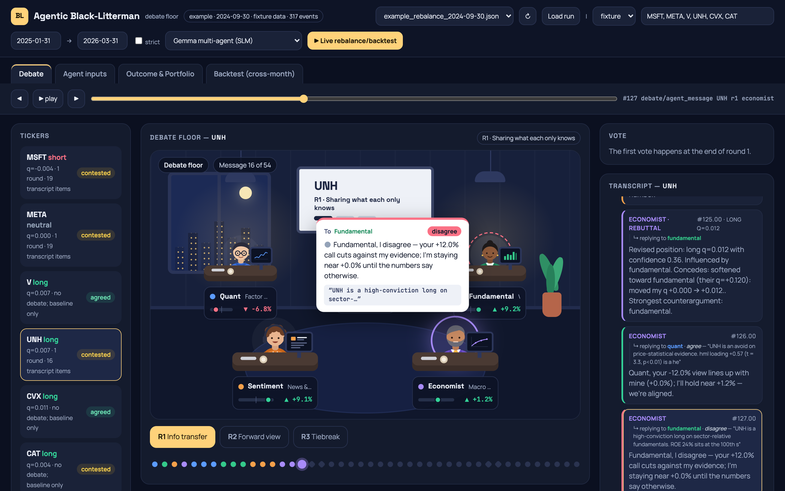
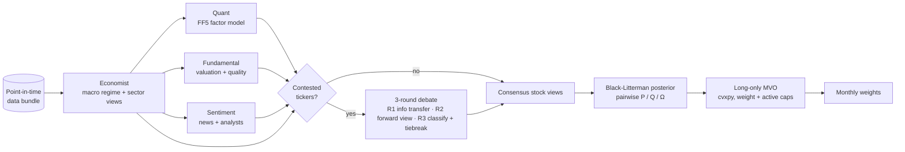
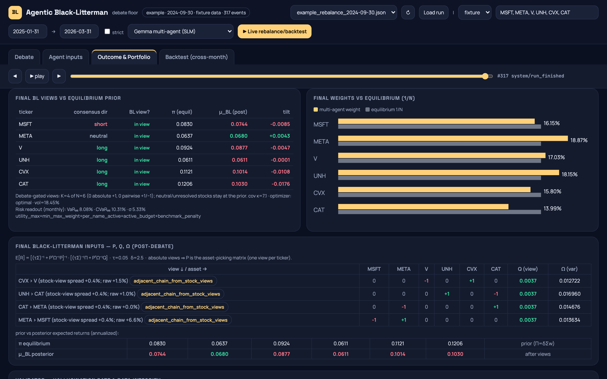
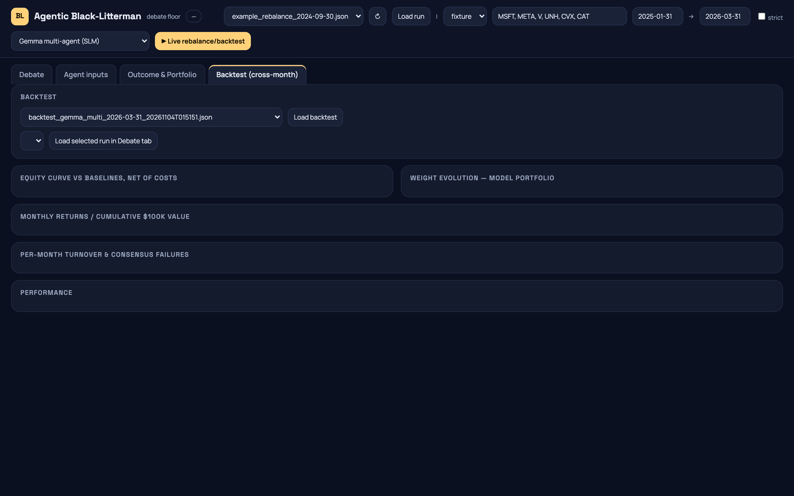

# Agentic Black-Litterman

**A multi-agent LLM debate that produces Black-Litterman views for a monthly portfolio rebalancer, with a web UI that replays the whole debate.**

Four specialist agents run on a small local model: Economist, Quant, Fundamental and News-Sentiment. They each form a view on every stock, argue over the contested names for up to three structured rounds, and agree on a set of views. Those views go into a from-scratch Black-Litterman posterior and a constrained long-only optimiser. The project's research question: can a debate between *small* language models (Gemma via Ollama) match a single *large* model (Gemini) as a source of portfolio views? It runs a matched 2×2 experiment to find out.



---

## How it works



1. **Phase 1, independent views.** The Economist runs first and passes its regime and sector stance to the other three. Each specialist gives every ticker a *categorical* signal (`strongly_long … avoid`) with a rationale and the numbers it cited. No agent writes BL math directly.
2. **Debate.** Tickers where the agents disagree go through up to three rounds. Each round does a different job, so later rounds aren't just "do you still agree?":
   - R1: share facts the others don't have.
   - R2: take a forward-looking position, naming who you agree or disagree with.
   - R3: classify the remaining disagreement and break the tie with a context agent.

   Guards keep the debate honest:
   - **Sycophancy guard.** Changing direction requires citing a new fact.
   - **Self-reference guard.** An agent can't name itself as its strongest counterargument.
   - **Thin moderator.** The moderator aggregates the agents' positions but contributes no view of its own.
3. **Validation.** Every number an agent cites is traced back to its input package (within 5%), giving a per-agent hallucination rate.
4. **Portfolio.**
   - Consensus stock views are calibrated into expected-return spreads and written as *pairwise* BL view rows.
   - Ω is set with the Idzorek method.
   - The posterior feeds a constrained mean-variance optimiser with per-name, active-weight and sector limits.
   - Covariance is checked to be symmetric and positive semi-definite, and is never silently replaced with the identity matrix.
5. **Backtest.** All of the above runs at every month-end. Results include transaction costs and are compared with equal-weight, max-Sharpe MVO and risk-parity baselines.

The design, with each spec item and where it lives in the code, is in [docs/DESIGN.md](docs/DESIGN.md).

---

## Quick start (offline, about 2 minutes)

The demo needs **no model, API key or data download**:
- A synthetic market supplies point-in-time data.
- When no model is reachable, the agents fall back to deterministic mocks built from their real input numbers.
- Every mocked call is flagged `used_mock=true` in the run log and in the UI.

```bash
git clone https://github.com/anjalika19/slm-agentic-portfolio-rebalancer.git
cd slm-agentic-portfolio-rebalancer
make install      # Python 3.11–3.13 venv in .venv + editable install
make demo         # http://localhost:8000
```

The UI opens with two bundled example runs from `examples/`:
- **Load run** opens a single-date debate.
- The **Backtest** tab has a 6-month backtest.
- **▶ Live rebalance/backtest** runs a fresh one and streams it live.

Without `make`:

```bash
python3.12 -m venv .venv && source .venv/bin/activate
pip install --prefer-binary -e ".[ollama]"
STRICT_MODEL=0 uvicorn agentic_bl.server.app:app --port 8000
```

From the command line:

```bash
STRICT_MODEL=0 agentic-bl-run                                            # one rebalance, prints weights
STRICT_MODEL=0 agentic-bl-backtest --start 2024-01-31 --end 2024-06-30   # backtest + debate evaluation
```

| Outcome tab: BL views, P/Q/Ω, weights vs 1/N | Backtest tab: equity curve vs baselines |
|---|---|
|  |  |

---

## Running with real models

Settings are read from environment variables or a local `.env` file (copy `.env.example`).

**Gemma via Ollama (the small-model path):**

```bash
ollama serve &               # or: python scripts/ollama_load.py
ollama pull gemma3
STRICT_MODEL=1 GEMMA_MODEL=gemma3:latest agentic-bl-run
```

**Gemini (the large-model control):**

```bash
pip install -e ".[gemini]"
export GEMINI_API_KEY=...
STRICT_MODEL=1 agentic-bl-backtest --mode gemini_c1 --start 2024-01-31 --end 2024-12-31
```

With `STRICT_MODEL=1`, a failed model call raises an error instead of falling back to a mock.

### Live market data

`--provider live` swaps the synthetic market for real point-in-time inputs:

| Source | Feeds | Notes |
|---|---|---|
| Bundled price CSVs and Kenneth French FF5 daily factors (`live_data/quant/data/`) | Quant | No key needed |
| FRED | Economist (macro) | Needs `FRED_API_KEY` |
| Bloomberg fundamentals export (`live_data/fundamental/data/Book1.xlsx`) | Fundamental | Bundled file |
| AlphaVantage → Finnhub → yfinance news | Sentiment | Needs `ALPHAVANTAGE_API_KEY` / `FINNHUB_API_KEY` |

```bash
pip install -e ".[live]"
agentic-bl-run --provider live --portfolio-id live6
```

Missing keys or files make the live provider **fail loudly**; it never mocks silently. `LIVE_ALLOW_FIXTURE_FALLBACK=1` fills the gaps from the fixture instead, and flags it.

---

## Evaluation design

**Matched 2×2: model size × architecture.** All four cells see the identical input bundle every month:

| | Single agent | Multi-agent debate |
|---|---|---|
| **Gemma (small model)** | `gemma_single` | `gemma_debate` |
| **Gemini (large model)** | `gemini_c1` | `gemini_debate` |

`agentic-bl-backtest --mode factorial` runs all four. It reports four things:
- the scale gap at each architecture;
- the gain from debate for each model;
- the interaction effect;
- how much of the small-vs-large gap the debate closes, on both gross and net-of-cost metrics.

**Does the debate add information?** Portfolio Sharpe can't answer that, because a good Sharpe may come from Phase 1 alone. So every backtest also scores the *views* themselves against the realised next-month return:

- **B1. Forward accuracy before and after debate.** Hit rate and Brier score.
- **B2. Corrections vs subversions.** How often the debate turns a wrong view right versus a right view wrong, plus the sycophancy rate.
- **B3. Hit rate by round.** If later rounds don't improve it, the debate behaves like a martingale and those rounds can be cut.

**Ablations** (`scripts/research/ablations.py`) cover:
- debate vs Phase 1 only;
- one model given all four data packages (specialisation vs deliberation);
- a *sham debate*, where each agent gets another ticker's peer facts, as a negative control.

---

## Project layout

```
src/agentic_bl/
  config.py              every tunable constant, env-overridable
  bl_core.py             covariance, Idzorek Ω, BL posterior, cvxpy optimiser, VaR/CVaR
  calibration.py         stock views → calibrated q → pairwise BL rows
  factor_model.py        rolling 60-month FF5 regressions with HAC errors
  backtest.py            monthly loop, baselines, 2×2 factorial, reporting
  evaluate.py            B1–B3 debate evaluation
  agents/                prompts, Ollama/Gemini client with schema enforcement, mocks
  pipeline/              LangGraph orchestration: phases, debate, validator
  providers/             fixture (synthetic) and live data providers
  server/app.py          FastAPI: replay endpoints + live run streaming
  arize.py               Phoenix/OpenTelemetry tracing setup (see Future work)
ui/                      single-page viewer (vanilla JS, no build step)
examples/                bundled sample runs shown in the UI
live_data/               live-mode loaders and data files
scripts/research/        ablations, calibration fitting, batch runs, replay analyses
scripts/make_examples.py regenerate examples/
docs/DESIGN.md           detailed design notes
```

---

## Limitations

- **The demo is not evidence.** The offline demo runs mock agents on a synthetic market, so it shows the machinery but its returns mean nothing. Real conclusions need Gemma/Gemini runs on live data.
- **Small universe.** The default book has six stocks, one per sector. That keeps debates readable but makes the portfolio statistics noisy.
- **Short history for LLM runs.** Backtests with real models cost a model call per agent, per round, per ticker, per month, so the evaluation window is short.

## Future work

- **Arize Phoenix observability.** `agentic_bl/arize.py` already sets up Phoenix and OpenTelemetry (`pip install -e ".[tracing]"`, `PHOENIX_*` settings in `config.py`). The next step is to wire it into `agents/llm.py::structured_call` and the debate phases, so every agent call, debate round and tiebreak becomes a traced span. That would show prompt and response pairs, latency, token use and schema-repair retries alongside the replay UI.
- A larger, multi-name-per-sector universe, with sector-level pairwise views.
- Longer real-model backtests, run as a batch with `scripts/research/run_portfolio_batch.py`.
